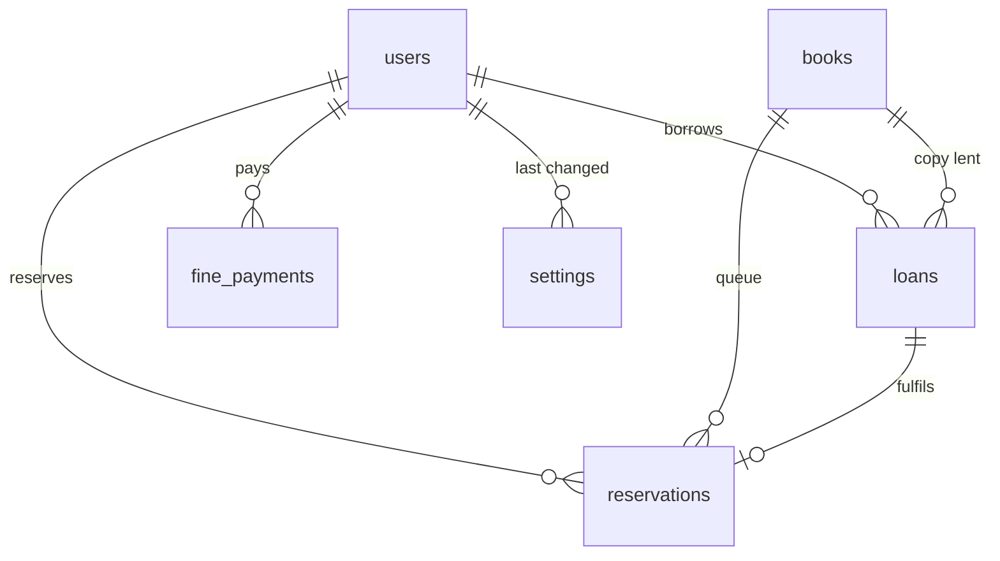

# Folio · Library Lending

A library lending system with a first-come reservation queue and overdue fines.

**Members** borrow books, reserve a book when every copy is out, and see their loans, due dates,
fines and reservations on one page. **Librarians** manage the catalogue, process returns (which
charge any overdue fine and hand the copy to the next person in the queue), record fine payments
and change the lending rules. Two members can never get the same copy, even when they click at the
same moment: the database itself refuses the second loan.

The requirements come from `4-Project-Library-Lending.pdf`. The specification, technical plan and
task list are in [`specs/`](specs/), written with GitHub Spec Kit.

## Contents

- [Features](#features)
- [Tech stack](#tech-stack)
- [Getting started](#getting-started)
- [Demo accounts and seed data](#demo-accounts-and-seed-data)
- [Lending rules](#lending-rules)
- [Where the last copy is protected](#where-the-last-copy-is-protected)
- [Paging large lists](#paging-large-lists)
- [API reference](#api-reference)
- [Data model](#data-model)
- [Project structure](#project-structure)
- [Automated tests](#automated-tests)
- [Environment variables](#environment-variables)
- [Troubleshooting](#troubleshooting)

## Features

**Members**

- Browse and search the catalogue (title or author), with Available and My books filters. Books
  load 24 at a time as you scroll.
- Borrow a free copy; the due date follows the configured loan period.
- Reserve a book when every copy is out, see your place in the queue, and borrow the copy when it
  is held for you.
- My account: books on loan with due dates (overdue in red), the fine building up, reservations,
  fines charged, payments and history, each list paged.

**Librarians**

- Add books and change titles, authors and copy counts. Copies that are out cannot be removed;
  new copies go to the queue first.
- Loans & returns: every open loan, soonest due first, searchable and paged. Return charges the
  fine and shows who the copy is now held for.
- Members: every member with open loans, overdue loans, unpaid fines and blocked state; a member's
  account page with Record payment.
- Lending rules: change the six settings below; they apply straight away, with no restart.

**Both:** roles are enforced on the server, so the interface cannot be used to bypass them.

## Tech stack

| Part | Technology |
|------|------------|
| Language | TypeScript (strict) everywhere |
| Backend | Node.js 22, NestJS 11, TypeORM 0.3, JWT sign-in, bcrypt, class-validator, Swagger |
| Database | PostgreSQL 16 or newer, installed locally (no Docker); schema through migrations only |
| Frontend | React 18, Vite, Material UI 7, React Router 6 |
| Tests | Jest and Supertest against a real test database, with a fixed clock |

## Getting started

Every command runs from the `task-4-library-lending/` folder.

### Prerequisites

- Node.js 22 LTS
- PostgreSQL 16 or newer running locally. DBeaver (or any client) is handy for creating the
  database and looking at the data.

### 1. Configure

One `.env` file in this folder is read by the API, the backend scripts and the frontend.

```bash
cp .env.example .env
```

Set `DB_HOST`, `DB_PORT`, `DB_USER` and `DB_PASSWORD` to the same details your DBeaver connection
uses (the defaults are `localhost:5432` and user `postgres`). The other values can stay as they
are; see [Environment variables](#environment-variables).

### 2. Create the database

In DBeaver, open your PostgreSQL connection, right-click **Databases** → **Create New Database**
and name it `library_lending` (the `DB_NAME` value). The test database is created automatically
by the tests.

### 3. Install, create the schema and load the demo data

```bash
cd backend && npm install && npm run migration:run && npm run seed
```

```bash
cd frontend && npm install
```

### 4. Run

API on `http://localhost:3050/api`, with interactive docs (Swagger) at `http://localhost:3050/api/docs`:

```bash
cd backend && npm run start:dev
```

Frontend on `http://localhost:5177`:

```bash
cd frontend && npm run dev
```

Open `http://localhost:5177` and sign in with a demo account. The ports were chosen so this project
can run next to tasks 1–3.

## Demo accounts and seed data

All demo accounts use the password in `SEED_DEMO_PASSWORD` (`demo-only-password` in
`.env.example`). The sign-in page lists both demo accounts with that password and a **Use** button
that fills the form.

| User ID | Role | What you'll see |
|---------|------|-----------------|
| `librarian@example.test` | Librarian | Catalogue with Add and Edit, Loans & returns, Members, Lending rules |
| `member1@example.test` … `member10@example.test` | Member | Catalogue with Borrow and Reserve, My account |

`npm run seed` creates, counted back from the moment it runs:

- 40 books with 1 to 5 copies (99 copies in all) and 10 members
- 25 loans: 16 open (7 of them overdue) and 9 returned (8 of them late, with fines)
- 2 fine payments
- 7 reservations: queues on Moby-Dick, The Great Gatsby, Crime and Punishment and War and Peace,
  and a copy of Middlemarch held for `member4`
- `member10` owes more than the blocking threshold, so they cannot borrow

Running the seed a second time does nothing. The demo password is built into the frontend for the
sign-in page, so leave `SEED_DEMO_PASSWORD` out of the `.env` used for any real deployment, and
never reuse it for real accounts.

## Lending rules

| Rule | How it works |
|------|--------------|
| Due date | Checkout time + loan period. |
| Loan limit | A member can have at most the maximum active loans, and one copy of each book. |
| Fine | Returned at or before the due time: no fine. After it, every started day counts as one day late. Fine = days late × daily fine, capped per loan. The fine is saved at return, so later setting changes never alter it. |
| Blocking | A member whose unpaid fines (charged minus paid) are over the threshold cannot borrow or reserve. Exactly at the threshold is allowed. |
| Payments | Recorded by a librarian; a payment cannot be more than the unpaid balance. |
| Reserving | Only when no copy is free, once per book, not for a book you already have. |
| Queue | Strictly first come, first served. A copy that becomes free (return, cancelled or expired hold, new copy) is held for the first waiting member. Only that member can borrow it. |
| Hold expiry | A hold ends at exactly its expiry time and the copy passes to the next member at that same moment, or back to the shelf if nobody is waiting. A background job does this every few seconds, and every action on a book does it first, so the result never depends on when the job runs. |

### Configurable values

Librarians change these on the **Lending rules** page. Every rule reads them from the database each
time it runs, so a change applies to the next checkout, return or hold without a restart.

| Setting | Default | Allowed | Used by |
|---------|---------|---------|---------|
| Loan period (`loanPeriodDays`) | 14 days | 1–90 | Due date at checkout |
| Fine per day late (`finePerDayCents`) | $0.25 | $0–$100 | Fine at return |
| Fine cap per loan (`maxFinePerLoanCents`) | $10.00 | $0–$1,000 | Fine at return |
| Maximum active loans (`maxActiveLoans`) | 5 | 1–20 | Checkout |
| Reservation hold window (`reservationHoldHours`) | 48 hours | 1–336 | Each new hold |
| Borrowing block threshold (`fineBlockThresholdCents`) | $10.00 | $0–$1,000 | Checkout and reserving |

Money is stored in whole cents and shown in the currency set by `VITE_CURRENCY`.

## Where the last copy is protected

Copies are numbered 1…N within each book. A copy is on loan while it has a loan whose
`returned_at` is empty. A migration creates this index:

```sql
CREATE UNIQUE INDEX ux_loans_open_copy
  ON loans (book_id, copy_number) WHERE returned_at IS NULL;
```

1. **The database is the guarantee.** PostgreSQL checks this index on every insert from every
   connection, so two checkouts of the same last copy cannot both succeed: not from a modified
   client, a direct API call or a bug in the service. Test `T-RACE-03` writes a second loan with
   raw SQL and the database refuses it.
2. **A lock on the book keeps the queue fair.** Every change to a book's copies or queue (checkout,
   reservation, return, cancellation, hold expiry, copy-count change) first locks that book's row,
   so changes to one book happen one at a time. A return therefore hands its copy to the first
   person waiting before anyone else can grab it (`T-RACE-04`).
3. **The service gives friendly errors.** It looks for a free copy first so it can answer
   `NO_COPY_AVAILABLE`, and turns an index refusal into the same answer.
4. **The interface is only a convenience.** Buttons only show what you can do; nothing relies on that.

Other partial unique indexes: one copy of a book per member (`ux_loans_open_member_book`), one
active reservation per member per book (`ux_reservations_one_active`, so a double click cannot
join twice) and one hold per copy (`ux_reservations_ready_copy`).

## Paging large lists

Nothing loads a whole table at once.

| List | How it is paged |
|------|-----------------|
| Catalogue | 24 books at a time in title order, using a cursor: each page returns `nextCursor`, and the next page starts right after it. Deep pages are as fast as the first, and nothing is repeated or skipped. The page loads more as you scroll, with a **Load more books** button as a fallback. Search uses trigram indexes (`pg_trgm`), so "contains" searches stay fast. |
| My account, member page, Loans & returns, Members | Page numbers with 5, 10, 25 or 50 rows per page (the API accepts up to 100). Summary tiles come from server totals, so they are right whatever page you are on. |

## API reference

All routes are under `/api` and, except sign-in, need `Authorization: Bearer <token>`. Full
request and response schemas are in Swagger at `/api/docs`.

| Method and path | Who | Purpose |
|-----------------|-----|---------|
| `POST /auth/login` | anyone | Sign in; returns a token and the user |
| `GET /auth/me` | signed in | The current user |
| `GET /books?search=&filter=all\|available\|mine&limit=&cursor=` | signed in | One page of the catalogue with availability (`mine` is for members) |
| `GET /books/:id` | signed in | One book |
| `POST /books`, `PATCH /books/:id` | librarian | Add a book; change title, author or copies |
| `POST /books/:id/checkout` | member | Borrow a copy |
| `POST /books/:id/reservations` | member | Join the queue |
| `POST /reservations/:id/cancel` | member (own) | Leave the queue or give up a held copy |
| `GET /loans?overdue=&search=&page=&pageSize=` | librarian | One page of open loans, plus desk totals |
| `POST /loans/:id/return` | librarian | Return; charges the fine and passes the copy on |
| `GET /members?search=&page=&pageSize=` | librarian | One page of members, plus totals |
| `GET /members/:id/account` | librarian, or the member | Account totals, counts and held copies |
| `GET /members/:id/loans?state=open\|returned\|fined&page=&pageSize=` | librarian, or the member | One page of that member's loans |
| `GET /members/:id/reservations`, `GET /members/:id/payments` | librarian, or the member | One page of reservations or payments |
| `POST /members/:id/payments` | librarian | Record a fine payment |
| `GET /settings`, `PATCH /settings` | signed in, librarian | Read or change the lending rules |

**Errors** always look like `{ "error": { "code", "reason?", "message", "details?" } }`:

| Code | Status | When |
|------|--------|------|
| `UNAUTHENTICATED` | 401 | Missing, invalid or expired token, or wrong email or password |
| `FORBIDDEN` | 403 | Your role cannot do this, or it belongs to another member |
| `NOT_FOUND` | 404 | No such book, loan, reservation or member |
| `VALIDATION_ERROR` | 400 | A field is missing or invalid; `details.fields` names it |
| `RULE_VIOLATION` | 409 | A lending rule refused it; `reason` is one of `ALREADY_BORROWED`, `ALREADY_RESERVED`, `BORROWING_BLOCKED`, `COPIES_AVAILABLE`, `COPIES_IN_USE`, `INVALID_STATE`, `LOAN_LIMIT_REACHED`, `NO_COPY_AVAILABLE`, `PAYMENT_EXCEEDS_BALANCE` |

## Data model



| Table | What it holds | Rules the database enforces |
|-------|---------------|-----------------------------|
| `users` | Members and librarians: email, name, bcrypt password hash, role | Unique lower-case email |
| `settings` | The six lending rules, with who changed each one and when | One row per setting; defaults apply when a row is missing |
| `books` | Title, author, number of copies | Title and author not blank; 0–100 copies |
| `loans` | One row per checkout: book, copy number, member, checkout and due times, return time, days late, fine | **One open loan per copy**; one open loan per member per book; due after checkout; a fine only once returned |
| `reservations` | The queue: book, member, queue order, status (`waiting`, `ready`, `fulfilled`, `expired`, `cancelled`), held copy, hold start and end | One active reservation per member per book; one hold per copy |
| `fine_payments` | Payments: member, amount, note, librarian, time | Amount above zero |

Availability, queue positions and balances are calculated when read and never stored, so they
cannot drift out of date. All schema changes go through the migrations in
`backend/src/database/migrations/`.

## Project structure

```text
task-4-library-lending/
├── .env.example            settings template (copy to .env)
├── README.md
├── specs/                  spec.md (what), plan.md (how), tasks.md (build steps)
├── backend/                NestJS API
│   ├── src/
│   │   ├── main.ts, app.module.ts, app-setup.ts
│   │   ├── auth/  users/   sign-in, JWT and roles guards, @Roles / @Public / @CurrentUser
│   │   ├── settings/       the six lending rules
│   │   ├── books/          catalogue: add, edit, paged search with availability
│   │   ├── lending/        checkout, returns, fines, reservations, holds, accounts, payments
│   │   │   ├── copy-queue.ts        book lock, free copies, queue hand-over, hold expiry
│   │   │   ├── loans.service.ts     reservations.service.ts     accounts.service.ts
│   │   │   ├── hold-expiry.service.ts   background job
│   │   │   └── utils/lending-rules.util.ts   pure rules (+ unit tests)
│   │   ├── common/         clock, error format, validation, paging, helpers
│   │   ├── config/         .env validation
│   │   └── database/       connection, migrations/, seeds/
│   └── test/               API tests (*.e2e-spec.ts) and support/ (test app, fixed clock, factories)
└── frontend/               React app
    ├── public/favicon.svg
    └── src/
        ├── api/            API client, types, paging hooks
        ├── auth/           sign-in page, session, route guards
        ├── layout/         sidebar layout
        ├── catalogue/      book cards, lazy loading, add/edit dialog
        ├── account/        My account and the account view librarians also use
        ├── loans/          Loans & returns
        ├── members/        member list and member page
        ├── settings/       Lending rules
        └── components/     shared pieces: covers, tiles, status tags, pager
```

## Automated tests

There are **56 automated tests**: 7 unit tests of the pure lending rules and 49 API tests that
run the whole application against a real PostgreSQL test database.

```bash
cd backend && npm run test:all
```

| Command | What it runs |
|---------|--------------|
| `npm test` | Unit tests only (no database) |
| `npm run test:e2e` | API tests only |
| `npm run test:all` | Both |

How the API tests work:

- They create and migrate their own `DB_NAME_TEST` database and empty it before each test, so
  your data is never touched. PostgreSQL must be running.
- The clock is fixed (it starts at `2026-03-10T12:00:00Z` and tests move it), so fines and hold
  expiry are checked to the exact millisecond.
- The background expiry job is switched off and the tests run it themselves at chosen times.
- Every test name starts with the ID of the requirement it proves (see [specs/spec.md](specs/spec.md)).

**Last run: 2026-11-07, 56 of 56 passing.**

### What the brief's "Done means" is proven by

| Requirement | Tests |
|-------------|-------|
| Fine calculation tested with a fixed clock | `T-FINE-01` … `T-FINE-03`, `T-UNIT-02`, `T-UNIT-03` |
| Reservation expiry tested with a fixed clock | `T-EXP-01` … `T-EXP-04`, `T-UNIT-05` |
| Queue order is correct | `T-RES-02`, `T-RES-04`, `T-RES-05`, `T-EXP-04`, `T-RACE-05` |
| Two members cannot both get the last copy | `T-RACE-01` … `T-RACE-04` |
| Roles are enforced on the server | `T-AUTH-01` … `T-AUTH-05` |
| Changing a setting changes behaviour without a code change | `T-CFG-03` … `T-CFG-07` |

### Every test

**Lending rules (unit)** — `src/lending/utils/lending-rules.util.spec.ts`

| ID | Checks that |
|----|-------------|
| T-UNIT-01 | The due date is the checkout time plus the loan period |
| T-UNIT-02 | Days late counts every started day after the due time |
| T-UNIT-03 | The fine is days late × daily fine, up to the cap |
| T-UNIT-04 | Borrowing is blocked only when the balance is over the threshold |
| T-UNIT-05 | A hold lasts the window and is expired from its exact end |
| T-UNIT-06 | The lowest free copy is chosen, or none when all are taken |
| T-UNIT-07 | Lowering the copy count identifies exactly the copies it would remove |

**Sign-in and roles** — `test/auth.e2e-spec.ts`

| ID | Checks that |
|----|-------------|
| T-AUTH-01 | Sign-in returns a token and role; a wrong password and an unknown email get the same 401 |
| T-AUTH-02 | No token or a bad token gets 401 on every route |
| T-AUTH-03 | A member cannot manage books, process returns, record payments, list loans or members, or change settings |
| T-AUTH-04 | A librarian cannot check out or reserve |
| T-AUTH-05 | A member cannot read another member's account or lists, or cancel their reservation |

**Catalogue** — `test/catalogue.e2e-spec.ts`

| ID | Checks that |
|----|-------------|
| T-CAT-01 | A librarian adds a book and it is listed with every copy available |
| T-CAT-02 | Blank titles or authors and negative, fractional or too large copy counts are refused; 0 copies is allowed |
| T-CAT-03 | Lowering the copy count over a copy that is out is refused; over free copies it works |
| T-CAT-04 | Search matches title or author and shows availability and the member's own loan or reservation |
| T-CAT-05 | The catalogue is paged by cursor in title order, with no book repeated or skipped |
| T-CAT-06 | The Available and My books filters run on the server, with their own totals |

**Checkout** — `test/loans.e2e-spec.ts`

| ID | Checks that |
|----|-------------|
| T-LOAN-01 | A member gets the lowest free copy, due one loan period later |
| T-LOAN-02 | A member at the loan limit cannot borrow until they return one |
| T-LOAN-03 | No free copy gives `NO_COPY_AVAILABLE`; a second copy of the same book gives `ALREADY_BORROWED` |
| T-LOAN-04 | Fines over the threshold block checkout; exactly at the threshold they do not |
| T-LOAN-05 | The loans desk is paged and searchable, with totals across all loans |

**Returns and fines** — `test/fines.e2e-spec.ts`

| ID | Checks that |
|----|-------------|
| T-FINE-01 | A book returned at exactly its due time has no fine |
| T-FINE-02 | 1 ms late is 1 day, 3 days is 3, 3 days + 1 ms is 4, at the daily fine |
| T-FINE-03 | The fine stops at the cap however late the book is |
| T-FINE-04 | Payments reduce the balance and can never exceed it |
| T-FINE-05 | A loan cannot be returned twice |

**Reservation queue** — `test/reservations.e2e-spec.ts`

| ID | Checks that |
|----|-------------|
| T-RES-01 | Members reserve only when no copy is free, once per book, and not while they have it or are blocked |
| T-RES-02 | Copies are held for waiting members strictly in the order they reserved |
| T-RES-03 | A held copy can be borrowed only by the member it is held for |
| T-RES-04 | Leaving the queue keeps the order; giving up a held copy passes it to the next member |
| T-RES-05 | New copies go to the queue first, in order |

**Hold expiry** — `test/expiry.e2e-spec.ts`

| ID | Checks that |
|----|-------------|
| T-EXP-01 | Nothing changes 1 ms before expiry; at the exact expiry time the copy passes on |
| T-EXP-02 | At the expiry time, even before the job runs, the copy already belongs to the next member |
| T-EXP-03 | When the last member's hold expires, the copy is free for anyone |
| T-EXP-04 | A job that runs days late still processes each hold at its own expiry time |

**Concurrency** — `test/concurrency.e2e-spec.ts`

| ID | Checks that |
|----|-------------|
| T-RACE-01 | Two members checking out the last copy at the same moment: exactly one wins, 25 times in a row |
| T-RACE-02 | Ten members at once: exactly one wins |
| T-RACE-03 | The database itself refuses a second open loan of a copy, bypassing the API |
| T-RACE-04 | A return racing another member's checkout always hands the copy to the waiting member |
| T-RACE-05 | Members reserving at once get distinct queue places; a double click makes one reservation |

**Accounts and members** — `test/accounts.e2e-spec.ts`

| ID | Checks that |
|----|-------------|
| T-ACC-01 | The account shows loans with due and overdue days, fines, payments, balance and reservations |
| T-ACC-02 | The member list shows loans, overdue loans, balance and who is blocked, with totals |
| T-ACC-03 | Account lists are paged with totals, and page sizes over 100 are refused |
| T-ACC-04 | The member list is paged by name and searchable, while totals cover every member |

**Configuration** — `test/config.e2e-spec.ts`

| ID | Checks that |
|----|-------------|
| T-CFG-01 | Defaults apply on a fresh install; a change is saved with who made it and when |
| T-CFG-02 | Out-of-range, fractional, text and unknown settings are refused and nothing changes |
| T-CFG-03 | Changing the loan period changes the next due date |
| T-CFG-04 | Changing the daily fine and the cap changes the next fine |
| T-CFG-05 | Changing the maximum active loans changes how many a member can borrow |
| T-CFG-06 | Changing the hold window changes how long the next hold lasts |
| T-CFG-07 | Lowering the blocking threshold blocks a member who was under the old one |

**Seed data** — `test/seed.e2e-spec.ts`

| ID | Checks that |
|----|-------------|
| T-SEED-01 | The seed creates 40 books with varying copies, 10 members and 25 loans, some overdue |
| T-SEED-02 | No copy is lent twice, nobody is over the limit, every fine follows the rule, and queues exist only for busy books |
| T-SEED-03 | Running the seed again adds nothing |

## Environment variables

All in the single `.env` in this folder. The API checks them at startup and stops with a clear
message if one is missing or invalid.

| Variable | Example | Purpose |
|----------|---------|---------|
| `DB_HOST`, `DB_PORT` | `localhost`, `5432` | Your PostgreSQL server |
| `DB_USER`, `DB_PASSWORD` | `postgres`, … | PostgreSQL login (same as your DBeaver connection) |
| `DB_NAME` | `library_lending` | The app's database (create it first) |
| `DB_NAME_TEST` | `library_lending_test` | Test database, created and emptied by the tests; must differ from `DB_NAME` |
| `API_PORT` | `3050` | API port |
| `CORS_ORIGIN` | `http://localhost:5177` | The frontend address allowed to call the API |
| `JWT_SECRET` | 16+ characters | Signs sign-in tokens; use a long random value outside development |
| `JWT_EXPIRES_IN` | `8h` | How long a sign-in lasts |
| `HOLD_SWEEP_INTERVAL_SECONDS` | `5` | How often expired holds are passed on (`0` turns the job off) |
| `SEED_DEMO_PASSWORD` | `demo-only-password` | Password of the demo accounts; also shown on the sign-in page |
| `FRONTEND_PORT` | `5177` | Frontend port |
| `VITE_API_BASE_URL` | `http://localhost:3050/api` | Where the frontend sends API calls |
| `VITE_CURRENCY` | `USD` | Currency fines are shown in (ISO 4217 code) |

## Troubleshooting

| Problem | Fix |
|---------|-----|
| `database "library_lending" does not exist` | Create it in DBeaver (step 2), then run the migrations again. |
| Tests fail with `Cannot reach PostgreSQL` | Start PostgreSQL and check the `DB_*` values in `.env`. |
| Migration fails on `CREATE EXTENSION pg_trgm` | The user in `DB_USER` must own the database or be a superuser. `pg_trgm` ships with PostgreSQL. |
| Sign-in says the email or password is incorrect | Run `npm run seed` in `backend`, and use the password in `SEED_DEMO_PASSWORD`. |
| `Port 3050 (or 5177) is already in use` | Another copy is already running; stop it, or change `API_PORT` / `FRONTEND_PORT` (and `CORS_ORIGIN`, `VITE_API_BASE_URL`). |
| The browser tab still shows an old icon | Browsers cache favicons; do a hard refresh (Ctrl+F5). |
